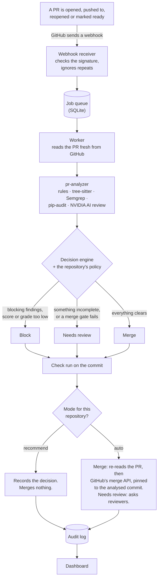

# How review-app works

review-app is an automatic reviewer for pull requests. When a pull request (PR) is opened or
updated on GitHub, review-app grades it with [pr-analyzer](../pr-analyzer) and decides one of
three things: **merge** it, ask a person to **review** it, or **block** it. It records every step
so you can see later what it did and why.

This guide explains how all of that fits together, in plain words. For installing and running
it, see [README.md](README.md). For the reasoning behind the design, see [DESIGN.md](DESIGN.md).

## In one minute

- GitHub tells review-app about a PR by sending a **webhook** (an automatic web request).
- review-app puts a job in a **queue**. A **worker** picks it up, reads the PR from GitHub and
  runs **pr-analyzer** on it: code checks, security scanners and an AI review on NVIDIA's models.
- A **decision engine** compares the result with the repository's **policy** (your thresholds)
  and decides: merge, needs review, or block.
- review-app reports the decision on the PR as a check, and merges only if you've allowed it for
  that repository. It's **recommend-only by default**, so out of the box it merges nothing.
- Every step goes into an **audit log** that can't be edited quietly, and a **dashboard** shows
  it all.

## The pieces

| Piece | What it does | Where |
|---|---|---|
| Webhook receiver | Takes GitHub's webhooks, checks they're genuine, queues work | `review-app webhook`, [web.py](src/review_app/web.py), [webhooks.py](src/review_app/webhooks.py) |
| Job queue | A list of work waiting to be done, kept in the database so nothing is lost on a restart | [jobs.py](src/review_app/jobs.py) |
| Worker | Takes jobs from the queue: analyse, decide, act | [worker.py](src/review_app/worker.py) |
| pr-analyzer | Grades the PR: pattern rules, code structure (tree-sitter), Semgrep, pip-audit, and the AI review | [../pr-analyzer](../pr-analyzer), driven by [analysis.py](src/review_app/analysis.py) |
| Decision engine | Turns the grade, the PR's facts and the policy into merge / needs review / block | [decision.py](src/review_app/decision.py) |
| Policy | Your rules per repository: thresholds, mode, merge method, reviewers | `review-app.toml`, [policy.py](src/review_app/policy.py) |
| Action executor | Carries the decision out: check run, reviewer requests, the merge itself | [actions.py](src/review_app/actions.py), [github_app.py](src/review_app/github_app.py) |
| Audit log | An append-only record of every decision and action | [db.py](src/review_app/db.py) |
| Dashboard | A read-only website showing all of the above | `review-app dashboard`, [web.py](src/review_app/web.py), [templates/](src/review_app/templates) |
| Login (optional) | Admin sign-in through Supabase, for when the dashboard leaves your machine | [auth.py](src/review_app/auth.py) |

## A pull request's journey



Step by step:

1. **GitHub sends a webhook.** The receiver only accepts it if:
   - it's signed with your webhook secret (no secret set means nothing is accepted);
   - it's no bigger than 5 MiB;
   - it hasn't been seen before (GitHub's delivery id).
2. **A job is queued.** These PR events start an analysis: opened, reopened, a new push
   (`synchronize`), marked ready for review, and edited to point at another base branch.
   - Closing a PR cancels its waiting jobs.
   - The queue runs one job per PR at a time. A newer push replaces an older analysis that
     hasn't started yet.
3. **The worker reads the PR** from GitHub, using the GitHub App's short-lived installation token.
   - It skips a PR that's no longer open.
   - If new commits arrived since the webhook, it drops this job and queues one for the newest
     commit.
   - A job that hits a temporary error (GitHub having trouble, say) is retried with growing
     pauses, up to 3 tries.
   - A job whose worker died is picked up again after 30 minutes.
4. **pr-analyzer grades the PR.** It checks the changed files with its pattern rules and
   tree-sitter. Semgrep and pip-audit look for security problems. The AI review (NVIDIA NIM,
   `nvidia/nemotron-3-super-120b-a12b` by default) reads the diff. It gives a score out of 100, a
   grade (A+ down to F), findings with severities, and warnings about anything it couldn't do.
   With `post_review` on (the default), the review is also posted on the PR.
5. **The decision engine decides** (next section).
6. **The executor acts** on the decision (see "Recommend mode and auto mode").
7. **Everything is recorded:** the analysis, the decision with its reasons, each action, and its
   outcome. The dashboard shows it.

## How the decision is made

The rules are checked in this order. Defaults are shown, and you can change any of them per
repository in `review-app.toml`.

**1. Block** if any of these is true:
- pr-analyzer found **blocking findings**: issues at the severities in the repository's
  `.pr-analyzer.toml` `block_on` setting (CRITICAL and HIGH by default);
- the **score is under 65** (`block_below_score`);
- the **grade is below D**, which means an F (`block_below_grade`).

**2. Needs review** if any of these is true:
- the **analysis was incomplete** (see below), or it failed outright;
- the PR isn't open, comes from a **fork**, is a **draft**, or targets a branch other than the
  repository's default (`base_branches`);
- it changes a path that **always needs a person**: `.github/**`, `.pr-analyzer.toml`,
  `CODEOWNERS` (`review_paths`);
- the **AI review didn't run** and the policy requires it (`require_llm_review`, on by default);
- the **score is under 90** (`merge_min_score`), or the **grade is under A-** (`merge_min_grade`);
- the **confidence is under 0.8** (`merge_min_confidence`).

**3. Merge** otherwise. The decision always lists its reasons, and the PR page on the dashboard
shows them.

### What "incomplete" means

review-app treats any gap in the analysis as a reason not to merge:
- **pr-analyzer warned about something.** For example: the AI review was skipped or failed, or
  files were ignored. The one exception is "Could not post the GitHub review", which is about
  reporting, not checking.
- **A changed file came without a diff** (binary or too big), so nothing checked it.
- **GitHub listed fewer files** than the PR has.
- **A file's full content couldn't be fetched**, so only its diff was checked.
- **Semgrep or pip-audit isn't installed** where review-app runs.
- **A required check is switched off** in the repository's `.pr-analyzer.toml`.
- **New commits arrived** while the analysis ran.

### Confidence

Confidence is a number from 0 to 1. It says how much the grade can be trusted, and it's three
factors multiplied together:

**confidence = size × coverage × AI certainty**

- **Size:** 1.0 up to 400 changed lines, sliding down to 0.5 at 2,000 lines or more. Big
  changes are harder to review well.
- **Coverage:** from 0.7 to 1.0, by how much of the change is in languages pr-analyzer parses
  fully (or is documentation). The rest only gets the simpler checks.
- **AI certainty:** 1.0, minus 0.1 for each medium-or-worse AI finding the model was unsure of
  (its own confidence under 0.8), down to 0.6.

For example, a 1,200-line change entirely in Python, with no unsure AI findings, scores
0.75 × 1.0 × 1.0 = 0.75. That's under 0.8, so it goes to a person even if its grade is A.

## Recommend mode and auto mode

Each repository is in one of two modes.

| Decision | Recommend mode (the default) | Auto mode |
|---|---|---|
| Merge | Records "merge recommended" and does nothing else | Merges it, after the checks in "Safety rails" |
| Needs review | Records it | Asks the reviewers listed in the policy, never the PR's own author |
| Block | Records it | Records it |

**In both modes,** when review-app runs as the GitHub App it posts a check named `review-app`
on the commit: success for merge, neutral for needs review, failure for block. If you make that
check required in branch protection, a block stops anyone from merging. `review-app analyze`,
the try-it-on-one-PR command, never posts a check and never merges.

To switch a repository to auto mode, add it to `review-app.toml`:

```toml
[repos."owner/name"]
mode = "auto"
reviewers = ["your-github-login"]
```

Auto mode can only be set per repository. `mode = "auto"` under `[defaults]` is refused.

## Safety rails

These are built in and can't be switched off:

- **Recommend-only unless you opt a repository in.**
- **Never merges incomplete or failed analyses.** Any gap means "needs review".
- **Never merges a PR from a fork, a draft, or a PR into another base branch.** PRs that touch
  guarded paths always go to a person.
- **Checks again right before merging.** It re-reads the PR from GitHub and calls the merge off
  if anything changed: new commits, closed, now a draft, a fork, or a different base branch.
- **Merges only through GitHub's merge API, pinned to the exact commit it analysed.** So branch
  protection and required checks still apply, and a commit pushed in between is never merged
  unseen.
- **Waits for checks.** If GitHub holds the merge back for pending checks, review-app tries
  again when those checks pass, up to 5 times.
- **Doesn't retry a failed merge.** It's unclear what happened, so a person should look.
- **Trusts only signed webhooks.** Without a webhook secret, nothing is accepted.
- **Keeps a record nobody can quietly edit.** The audit log only grows: the database refuses
  changes or deletions to it. Each entry carries a hash of the one before, so a change made
  behind the app's back breaks the chain. `review-app audit-verify` and the dashboard check
  that chain.

## The dashboard

`review-app dashboard` serves a website at http://localhost:8001/. It only reads. **Nothing on
it changes anything on GitHub.**

| Page | What it shows |
|---|---|
| Overview | Whether auto-merge is on, the latest decision on each PR counted by verdict, decisions per day for two weeks, recent decisions, setup health (GitHub App, scanners, AI key, policy, login), repositories, and the job queue |
| Repository | That repository's policy, drawn as score bands, and its PRs |
| Pull request | The decision with its reasons and score, the three confidence factors, the score for each dimension, findings grouped by severity, earlier decisions, and the PR's audit trail |
| Audit log | Every recorded step, by day, with filters by repository and action, and whether the hash chain is intact |
| Jobs | The queue: how many jobs are queued, running, done or failed, and the latest ones |
| Sign in | Only when login is on (next section) |

- **Theme switch.** The sidebar has a Light / Dark / System switch. Your choice is kept in a
  cookie for a year. System follows your computer's setting.
- **Without login,** the dashboard only answers on your own machine (localhost).
- **Design.** It follows the shadcn/ui preset `b4N1arr72` (Oxanium font, mauve and purple).
  All its effects (3D tilt, the spinning cube, charts) are done in CSS and SVG, with no
  JavaScript. The one outside request it makes is for the Oxanium font, from Google Fonts.

## Login (optional)

Login matters once you want to open the dashboard from somewhere other than your own machine.
It uses Supabase Auth: Supabase keeps the accounts and passwords, and review-app stores neither.

- **It's off until set up.** Login stays off until `SUPABASE_URL` and `SUPABASE_ANON_KEY` are
  set. A half-finished setup stops the dashboard from starting.
- **Only listed admins.** Only the addresses in `REVIEW_APP_ADMIN_EMAILS` get in (or everyone
  at a domain, written `@example.com`). The list is checked on every page.
- **Sessions.** After you sign in, your session lives in secure cookies and renews itself. You
  sign in again after a week.
- **Throttling.** Five wrong passwords for an address, from one device, lock that pair out for
  15 minutes.
- **Endpoints.** `GET /login`; `POST /auth/login`, `/auth/logout` and `/auth/refresh`; and
  `GET /auth/me`.
- **Not built on purpose:** sign-up and password reset. Add users and reset passwords in the
  Supabase dashboard.

Setting it up step by step is in README.md, "Dashboard login (Supabase)".

## Where the data lives

Everything is in one SQLite file on the machine running review-app: `review-app.db` by
default, or the path in `REVIEW_APP_DB`.

| Table | Holds |
|---|---|
| `repositories` | Each repository: its GitHub App installation, its default branch, and whether the app is still installed |
| `pull_requests` | Each PR's title, author, branches, latest commit, and state |
| `analyses` | Each pr-analyzer run: score, grade, findings, warnings, the AI model used, how long it took |
| `decisions` | Each decision: verdict, confidence, reasons, the facts behind it, and what happened (merged, blocked, ...) |
| `jobs` | The work queue |
| `deliveries` | The webhook delivery ids already handled, so repeats are ignored |
| `audit_log` | The append-only, hash-chained record of everything |

There are no passwords or user accounts in it. review-app talks to these outside services:
- **GitHub:** reading PRs, posting checks and reviews, merging;
- **NVIDIA:** the AI review;
- **Supabase:** only if login is on;
- **Google Fonts:** the dashboard's font.

## Configuration

Two files sit in the folder you run review-app from.

**`.env`** holds secrets and settings (see [.env.example](.env.example)):

| Setting | For |
|---|---|
| `GITHUB_APP_ID`, `GITHUB_APP_PRIVATE_KEY_PATH`, `GITHUB_WEBHOOK_SECRET` | Running as the GitHub App (the webhook server and the worker) |
| `GITHUB_TOKEN` | `review-app analyze` without a GitHub App |
| `NVIDIA_API_KEY`, `LLM_MODEL` | The AI review (`LLM_PROVIDER` is `nvidia` unless you change it) |
| `REVIEW_APP_DB`, `REVIEW_APP_POLICY` | Where the database and the policy file are |
| `REVIEW_APP_WORKERS`, `REVIEW_APP_POLL_SECONDS` | How many jobs run at once, and how often the queue is checked |
| `REVIEW_APP_SKIP_LLM` | Skip the AI review (and so, by default, merge nothing) |
| `SUPABASE_URL`, `SUPABASE_ANON_KEY`, `SUPABASE_JWT_SECRET`, `REVIEW_APP_ADMIN_EMAILS`, `REVIEW_APP_DASHBOARD_HOSTS` | Dashboard login |

**`review-app.toml`** holds the policy (see
[review-app.example.toml](review-app.example.toml)): a `[defaults]` table, plus one table per
repository that differs.

| Key | Default | Meaning |
|---|---|---|
| `enabled` | `true` | `false` ignores the repository's PRs |
| `mode` | `"recommend"` | `"auto"` lets the app merge (per repository only) |
| `merge_min_score` / `merge_min_grade` / `merge_min_confidence` | 90 / A- / 0.8 | What a merge needs |
| `block_below_score` / `block_below_grade` | 65 / D | What blocks |
| `require_llm_review` | `true` | No merge without the AI review |
| `merge_method` | `"squash"` | `merge`, `squash` or `rebase` |
| `base_branches` | default branch | Branches PRs may be merged into |
| `review_paths` | `.github/**`, `.pr-analyzer.toml`, `CODEOWNERS` | Paths that always go to a person |
| `reviewers` / `team_reviewers` | none | Who's asked to review in auto mode |
| `post_review` | `true` | Post pr-analyzer's review on the PR |

`review-app check-config` checks both files and prints each repository's policy. An invalid
policy stops the app from starting rather than running on rules you didn't mean.

## Commands

| Command | What it does |
|---|---|
| `review-app analyze <PR URL> [--post-review]` | Grade one PR now with `GITHUB_TOKEN`. Prints the decision, merges nothing, posts nothing unless you ask |
| `review-app dashboard [--port 8001]` | The dashboard |
| `review-app webhook [--port 8000] [--no-worker]` | Receive GitHub's webhooks, and run the worker too unless told not to |
| `review-app worker` | The worker alone, beside `webhook --no-worker` |
| `review-app check-config` | Check `.env` and `review-app.toml`, and show each repository's policy |
| `review-app audit-verify` | Check that the audit log's hash chain is intact |

## Try it locally

You don't need a GitHub App for this.

1. Install it as in README.md, "Install".
2. Put a `GITHUB_TOKEN` (a personal access token that can read the repository) and an
   `NVIDIA_API_KEY` in `.env`.
3. Grade a PR:

   ```bash
   .venv/bin/review-app analyze https://github.com/owner/repo/pull/123
   ```

4. Look at the result:

   ```bash
   .venv/bin/review-app dashboard
   ```

   Then open http://localhost:8001/.

## Going live: a checklist

- [ ] **Create the GitHub App.**
  - Permissions: contents (read), pull requests (read and write), checks (read and write),
    commit statuses (read), metadata (read).
  - Events: pull request, check suite, status.
- [ ] **Generate the app's private key** and keep the `.pem` outside the repository. Set
  `GITHUB_APP_ID`, `GITHUB_APP_PRIVATE_KEY_PATH` and a long random `GITHUB_WEBHOOK_SECRET`.
- [ ] **Install the app** on the repositories to review.
- [ ] **Start the webhook server** (`review-app webhook`), and forward a public URL to
  `http://127.0.0.1:8000/webhook` (smee.io or a tunnel). Only this port should face the internet.
- [ ] **Set `NVIDIA_API_KEY`**, and check that Semgrep and pip-audit are installed:
  `review-app check-config`.
- [ ] **Run in recommend mode for a while** and read the decisions on the dashboard.
- [ ] **Optional:** set `mode = "auto"` for a repository you trust it with, and make the
  `review-app` check required in that repository's branch protection.
- [ ] **Optional, to open the dashboard from elsewhere:** create a Supabase project, add the
  admins, set the login settings and `REVIEW_APP_DASHBOARD_HOSTS`, and serve it over HTTPS.

## What runs today

- **review-app** is built and its code is on `main`. The newer dashboard work (the redesign,
  login, this design and the theme switch) is in open PRs.
  - **It isn't connected to GitHub yet.** No GitHub App has been created, so it doesn't see new
    PRs on its own. So far it has only been run by hand with `review-app analyze`.
  - **Login is built** but waits for a Supabase project.
- **The repository's own "PR Analysis" workflow** is a separate thing. It's GitHub Actions
  running pr-analyzer on each PR from this repository and posting a review. Its AI part is
  skipped because the repository has no AI key secret. PR #12 switches it to NVIDIA.
  - **Before adding an `NVIDIA_API_KEY` repository secret, read the review on PR #12.** As
    written, that workflow hands the key to code the pull request itself can change.
- **Qodo** is meant to review PRs too. When last checked, it hadn't commented on any PR here,
  and it may need installing as a GitHub App.
- **You merge PRs by hand.** review-app merging for you is the future auto mode, repository by
  repository.

## FAQ

**Will review-app merge my PRs right now?**
No. It isn't connected to GitHub yet, and even once it is, it's recommend-only until you set
`mode = "auto"` for a repository.

**Why does a PR with a perfect score say "needs review"?**
Some gate failed, and the reasons on the PR page say which. Often it's the analysis being
incomplete: for example, the AI review was skipped because `NVIDIA_API_KEY` isn't set. Or the PR
is already closed, or it touches `.github/`.

**Can it merge a PR from a fork?**
Never.

**What if someone pushes a new commit after the analysis?**
The merge is pinned to the analysed commit, and review-app re-reads the PR first, so the merge
is called off. The new commit gets its own analysis.

**Does the dashboard change anything on GitHub?**
No. It's read-only. With login on, its only requests that send anything are signing in, signing
out and renewing the session. The theme switch just sets a cookie in your browser.

**Where is my data?**
In one SQLite file on your machine (`review-app.db`). See "Where the data lives".

**How do I switch between light and dark?**
Use the Light / Dark / System switch in the sidebar.

**How do I check nobody tampered with the record?**
Run `review-app audit-verify`, or look at the top of the Audit log page.

## Glossary

| Word | Meaning |
|---|---|
| Pull request (PR) | A proposed change to a repository, waiting to be merged |
| Webhook | An automatic web request GitHub sends when something happens, such as a PR being opened |
| GitHub App | An identity review-app uses on GitHub. Installed on repositories, it gets short-lived **installation tokens** to read PRs and post results |
| Check run | A pass / neutral / fail result shown on a commit in GitHub. review-app's is named `review-app` |
| Verdict | The decision: merge, needs review, or block |
| Policy | Your rules for a repository, in `review-app.toml` |
| Confidence | How much the grade can be trusted: size × coverage × AI certainty |
| Recommend / auto mode | Report only, or actually merge and request reviewers |
| Audit log | The record of every step. Each entry is linked to the previous one by a hash, so changes show |
| Semgrep / pip-audit | Security scanners: one for code patterns, one for known-vulnerable dependencies |
| NVIDIA NIM | NVIDIA's hosted AI models, used for the AI review |
| Supabase | An online service that holds the dashboard's user accounts, when login is on |
| SQLite | A database kept in a single file |
